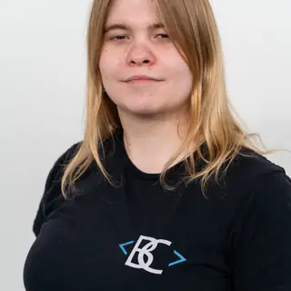

<picture>
  <source media="(prefers-color-scheme: dark)" srcset="./assets/profile-dark.svg">
  
</picture>

# Carina Sophie Schoppe

  
  <strong>Software engineer · IT lecturer · Founder of Luminovia</strong> 
  Brisbane, Australia · English and German

I build Python tools for research and automation, contribute to Linux audio software, and design hands-on IT training for adult learners.

<a href="https://carinaschoppe.com/"> Personal portfolio</a> · [Software projects](https://carinaschoppe.com/software) · [Luminovia](https://luminovia.org/) · [LinkedIn](https://www.linkedin.com/in/carinaschoppe/) · [ORCID](https://orcid.org/0009-0006-3211-5242)

## Selected projects

### PRISMA Literature Review Pipeline

A Python workbench for systematic literature reviews. Its desktop and command-line interfaces share a workflow for academic search, deduplication, citation expansion and AI-assisted screening. It records screening decisions and exports PRISMA-style reports. [Explore PRISMA](https://github.com/CarinaSchoppe/PRISMA-Literature-Review-Pipeline-Automation-Tool)

### Automatic Mail Sender System

A Python tool for preparing and sending templated outreach emails over SMTPS. Separate templates and attachments support different workflows, while dry runs, recipient deduplication and sent logs help manage each batch. [Explore Mail Sender](https://github.com/CarinaSchoppe/Automatic-Mail-Sender-System)

### OpenXLR

I contribute to OpenXLR’s Linux audio mixer. My changes cover recovery from frozen USB microphone capture, mixer layouts that adapt to wide windows, and faster local builds. [Capture recovery](https://github.com/emaspa/openxlr/pull/733) · [Mixer layout](https://github.com/emaspa/openxlr/pull/731) · [Build performance](https://github.com/emaspa/openxlr/pull/745)

## Luminovia Training & Consulting

I founded Luminovia to deliver technical training and consulting for organisations and education providers. I teach in English and German, design curricula and hands-on labs, and help teams evaluate AI use cases. Training covers areas such as Linux, networking, cybersecurity, Python and SQL. [Training programmes](https://luminovia.org/training) · [Consulting](https://luminovia.org/consulting)

## Research and qualifications

My research focuses on human–AI interaction at work and the governance of generative AI. I also worked on agentic AI as a senior research assistant at the University of Queensland. [Writing and research](https://carinaschoppe.com/blog)

**Qualifications.** B.Sc. and M.Sc. in Business Computer Science, MBA, and the Australian TAE40122 Certificate IV in Training and Assessment. [Credentials](https://carinaschoppe.com/credentials)

## Contact

- **Software collaboration, research or guest lectures.** [Personal contact](https://carinaschoppe.com/contact) · [Email](mailto:info@carinaschoppe.com)
- **Team training, curriculum design or consulting.** [Contact Luminovia](https://luminovia.org/contact)
