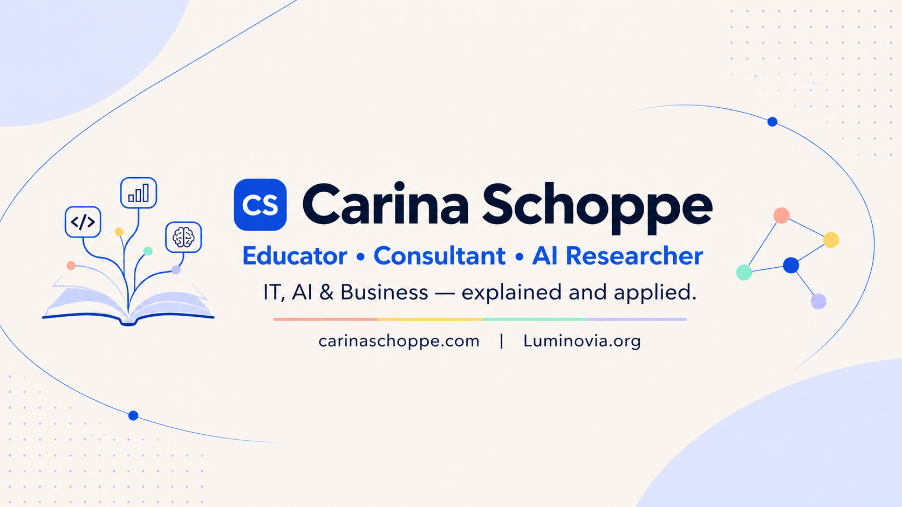
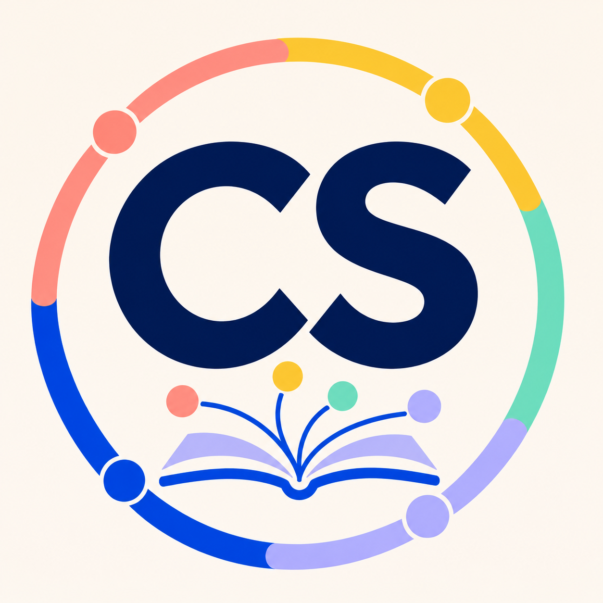
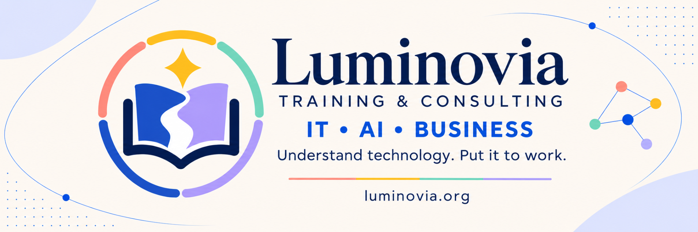

# Carina Sophie Schoppe

**Educator · Consultant · Manager · AI Researcher**

I help people and organisations understand technology, apply AI and turn business goals into practical outcomes. Based in Brisbane, Australia, I work across education, consulting, project management and AI research, supporting businesses and education providers in English and German.

**[Discuss training or consulting](https://luminovia.org/contact)** · [Personal portfolio](https://carinaschoppe.com/) · [LinkedIn](https://www.linkedin.com/in/carinaschoppe/)

## Work with Luminovia

I founded **[Luminovia Training & Consulting](https://luminovia.org/)** to help people understand technology and put it to work. We support businesses, education providers and universities through training, learning design and consulting in English and German.

- **Technical and business training.** Live courses and workshops with practical exercises in AI, Python, SQL, networking, cybersecurity and business IT. [Training programmes](https://luminovia.org/training)
- **Learning design.** Curricula, labs and assessments for workplace training and adult education. [Programme formats](https://luminovia.org/offers)
- **AI and IT consulting.** Assess use cases, review workflows and plan how to introduce AI or automation into everyday work. [Consulting services](https://luminovia.org/consulting)

**[Luminovia on GitHub](https://github.com/Luminovia-Training-Consulting)** · [Public teaching resources](https://github.com/Luminovia-Training-Consulting/CBW-Zusatzunterricht) · [Discuss a project](https://luminovia.org/contact)

## Selected software

### PRISMA Literature Review Pipeline

A Python workbench for systematic reviews. It brings academic search, deduplication, citation expansion and AI-assisted screening into one workflow, with a desktop interface, a CLI and exportable screening decisions. [Explore PRISMA](https://github.com/CarinaSchoppe/PRISMA-Literature-Review-Pipeline-Automation-Tool)

### Automatic Mail Sender System

A Python tool for preparing templated outreach and sending it over SMTPS. It supports separate templates and attachments for different workflows, dry runs, duplicate checks and sent logs. [Explore Mail Sender](https://github.com/CarinaSchoppe/Automatic-Mail-Sender-System)

### OpenXLR

I contribute to OpenXLR’s Linux audio mixer. My changes cover recovery from frozen USB microphone capture, layouts that adapt to wide windows and faster local builds. [Capture recovery](https://github.com/emaspa/openxlr/pull/733) · [Mixer layout](https://github.com/emaspa/openxlr/pull/731) · [Build performance](https://github.com/emaspa/openxlr/pull/745)

[More software projects](https://carinaschoppe.com/software)

## Research and qualifications

My research focuses on human–AI interaction at work and the governance of generative AI. At the University of Queensland, I worked on agentic AI as a senior research assistant. [Writing](https://carinaschoppe.com/blog) · [ORCID](https://orcid.org/0009-0006-3211-5242)

**Qualifications.** B.Sc. and M.Sc. in Business Computer Science, MBA, and the Australian TAE40122 Certificate IV in Training and Assessment. [Credentials](https://carinaschoppe.com/credentials)

For consulting, project management, research, guest lectures or software collaboration, reach me through my portfolio. [Personal contact](https://carinaschoppe.com/contact) · [Email](mailto:info@carinaschoppe.com)
